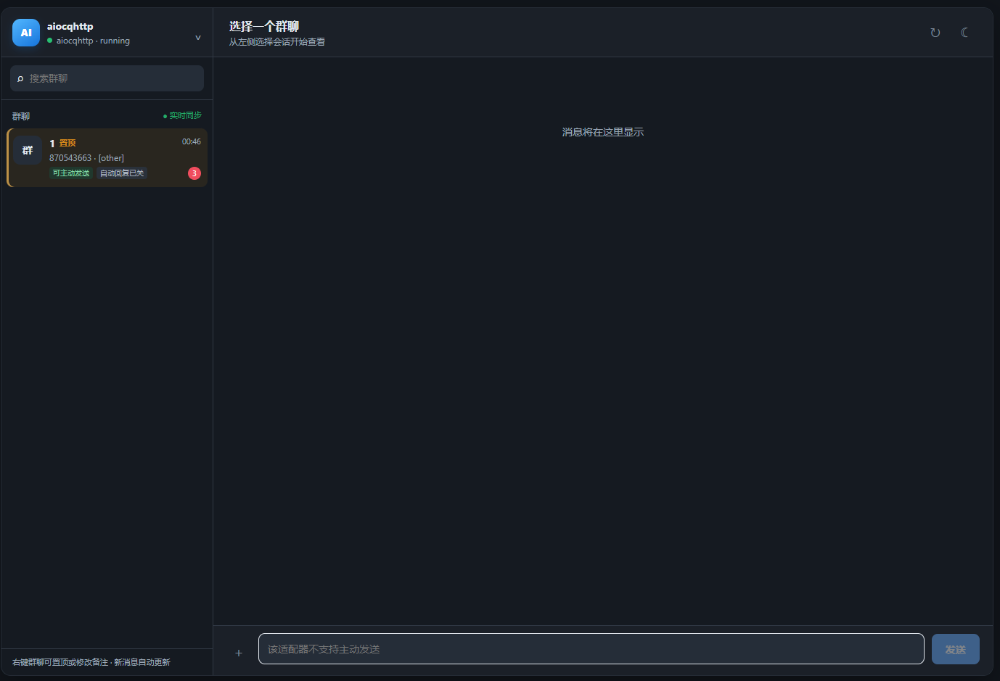

  

<h1 align="center">聊天控制台</h1>

  
  
  

在 AstrBot WebUI 中查看群聊消息、跟进未读提醒，并向支持主动发送的适配器回复消息。

## 效果示意

  

## 功能亮点

- **集中查看会话：** 按适配器整理已收到消息的群聊，并增量同步新消息。
- **未读与 @ 提醒：** 打开会话即标记已读，同时保留本次进入时的未读快照；可跳转到未读消息或 @ 你的消息。
- **发送消息：** 支持文本、图片和图文消息，具体取决于适配器能力与平台权限。
- **会话管理：** 支持置顶、修改本地备注，以及查看主动回复配置状态。
- **深色模式：** 默认深色，可在页面右上角即时切换；配置项可设置默认主题。
- **SQLite 存储：** 聊天记录保存至 SQLite；首次启动会自动导入旧版 `messages.json`。

## 安装

将插件目录放入 AstrBot 的 `data/plugins/`，或通过 AstrBot WebUI 的插件管理安装。启用插件后，在插件详情页打开“聊天控制台”。

- AstrBot：4.24.2 或更新版本
- 额外依赖：无

## 使用

选择左侧适配器和群聊即可查看消息。打开会话时，插件会保存已读状态；右上方的“查看未读消息”和“有人@我”按钮可定位对应消息。右键群聊可以置顶、修改备注或手动标记已读。

发送前，插件会检查适配器是否声明支持主动发送。平台权限、会话标识及策略也可能影响发送；不支持主动发送的适配器仍可用于查看已记录消息。

## 配置

在 **WebUI → 插件管理 → 聊天控制台 → 配置** 中启用或关闭“默认使用深色模式”。页面右上角的主题按钮可切换深色与浅色外观，选择会保存在当前浏览器；如果浏览器存储受限，页面仍可正常加载，并采用插件配置的默认主题。

## 数据与隐私

插件只记录启用后 AstrBot 实际收到的消息，不会下载平台的历史聊天记录。聊天记录保存在 `data/plugin_data/astrbot_plugin_chat_console/chat_console.db`，最多保留最近 5000 条。旧版 `messages.json` 成功导入后会改名为 `messages.json.migrated`。数据库、迁移备份、群备注和置顶设置仅用于运行环境，不应提交到代码仓库。

## TODO：适配情况

勾选表示已进行适配测试；未勾选表示尚未完成验证。OneBot v11 当前使用 NapCat 测试。

- [ ] 钉钉 (DingTalk)
- [ ] Telegram
- [ ] Discord
- [x] QQ 官方机器人 (WebSocket，推荐)
- [ ] QQ 官方机器人 (Webhook)
- [x] OneBot v11 (NapCat)
- [ ] 飞书 (Lark)
- [ ] 个人微信
- [ ] 企业微信 (智能机器人)
- [ ] 企业微信应用 & 微信客服
- [ ] 微信公众平台

## 交流答疑

欢迎加入交流群：**870543663**。
